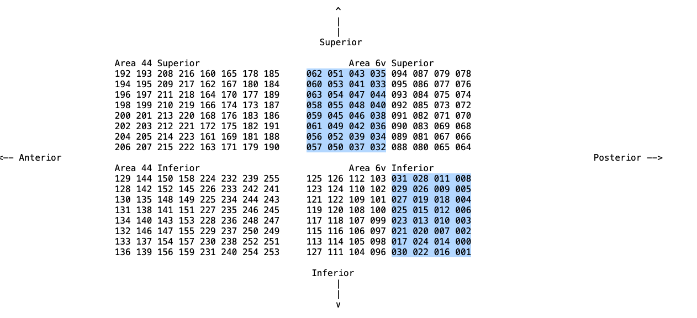
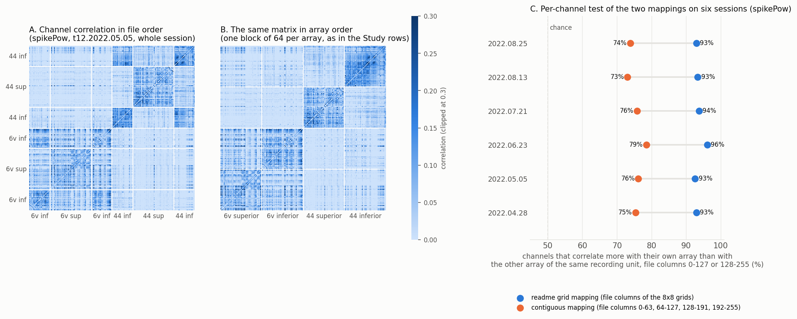

# Willett 2023: A High-Performance Speech Neuroprosthesis

Intracortical brain-to-text speech neuroprosthesis in one BrainGate2 participant (**T12**, a 67-year-old left-handed woman with bulbar-onset ALS and severe dysarthria). Four 64-channel Utah arrays (256 electrodes) in the left hemisphere, two in area 6v of the ventral precentral gyrus and two in area 44 of the inferior frontal gyrus, record 20 ms-binned threshold crossings and spike-band power while she attempts to speak cued sentences, vocalized or mouthed. The aim is to decode attempted speech into text.

**Working dataset = the `sentences` files** (24 sessions, 306 blocks, 10,900 trials, 20 ms-binned neural features plus per-trial sentence and timing). The same participant appears in [`kunz_2025`](../kunz_2025/README.md).

## References

- **Paper:** Willett, F. R., Kunz, E. M., Fan, C., Avansino, D. T., Wilson, G. H., Choi, E. Y., Kamdar, F., Glasser, M. F., Hochberg, L. R., Druckmann, S., Shenoy, K. V. and Henderson, J. M. *A high-performance speech neuroprosthesis.* **Nature** 620, 1031-1036 (2023). https://doi.org/10.1038/s41586-023-06377-x
- **Source data:** [10.5061/dryad.x69p8czpq](https://datadryad.org/dataset/doi:10.5061/dryad.x69p8czpq), license CC0 1.0
- **Code repository:** https://github.com/fwillett/speechBCI
- **Supplementary methods** ([PDF](https://static-content.springer.com/esm/art%3A10.1038%2Fs41586-023-06377-x/MediaObjects/41586_2023_6377_MOESM1_ESM.pdf), sections 1.1 participant, 1.4 signal processing, 1.6 and Table 2 sessions, 1.7 and Table 3 task timing, 1.9 real-time protocol) are cited below as "supplement".
- **The 50-sentence set:** Moses, D. A. et al. *Neuroprosthesis for decoding speech in a paralyzed person with anarthria.* **N. Engl. J. Med.** 385, 217-227 (2021). https://doi.org/10.1056/NEJMoa2027540

## Species & Subjects

- Human. Single BrainGate2 clinical-trial participant **T12**, registered as `braingate2/T12` in `datasets/participants.py`: a left-handed woman, 67 at the time of recording, with slowly progressive bulbar-onset amyotrophic lateral sclerosis (ALS) diagnosed at 59 (ALSFRS-R 26 at enrollment). She has been severely dysarthric for nearly eight years: she vocalizes while attempting to speak and produces some differentiable vowels, but no intelligible consonants or sentences. She retains partial use of her limbs and communicates through a writing board or tablet (supplement 1.1).
- **Implant:** four 64-electrode 1.5 mm SIROF Blackrock Utah arrays (**256 electrodes total**) placed on `2022-03-30` in the left hemisphere, two in **area 6v** of the ventral precentral gyrus and two in **area 44** of the inferior frontal gyrus (part of Broca's area), located with the Human Connectome Project multimodal parcellation. Two Neural Signal Processors (NSP1, NSP2), each wired to the two arrays of one area. The sentence sessions span post-implant days 29-148. Area 6v carries rich, spatially intermixed tuning to speech articulators, area 44 showed minimal production-related activity and was not decoded from.
- **Channel order.** The Study emits the 256 channels in array order, one block of 64 per array (`dorsal_6v, ventral_6v, dorsal_44, ventral_44`, the source's superior and inferior arrays). The source files interleave the arrays, see [Channel order](#channel-order). No verified channel correspondence with T12's arrays in `kunz_2025` is documented.

## Behavioral Task

**Instructed-delay sentence production** (supplement 1.7). The sentence appears as text above a red square. After a randomized delay the square turns green and T12 attempts to speak the sentence, vocalized on 20 days and mouthed without vocalizing on 4. In open-loop (`OL`) blocks she ends the trial with a button held in her lap, which starts the next trial's delay. Sentences come from Open WebText (the four initial training days), the Switchboard corpus (every later day) and the fixed 50-sentence set of Moses et al. 2021, labelled `Chang` in the files. Blocks hold 20 trials on the four Open WebText days and 40 on most later blocks (25 or 50 on a few), and were recorded minutes to an hour apart. In closed-loop (`CL`) blocks the day's decoder ran in real time (supplement 1.9): the first button press ends her attempt, the decoded text is shown and read aloud by the computer, and a second press starts the next trial. The pause between the two presses is `trialState` code `3` (see Data Modalities).

**Block vocabulary.** Every block carries one of nine labels (`blockTypes`). On the evaluation days (supplement 1.9) the `Stage 1` decoder was trained on that day's open-loop blocks together with all prior-session data. After the `Stage 1` closed-loop blocks were collected, the decoder was retrained with those additional blocks to produce the `Stage 2` decoder. The pilot days explored other online settings but share the block structure. The three `CL Switchboard Stage 1 Repeat` blocks present one fixed set of 40 Switchboard sentences on 06.02 (25 of them), 06.07 and 06.14. The `OL Switchboard Repeat` block of 06.16 holds 40 distinct sentences that mostly occur nowhere else, so the files do not explain its label. All four `Repeat` blocks are outside the competition partition.

| block type | blocks | trials | sessions | meaning |
|---|---|---|---|---|
| `OL Open WebText` | 66 | 1,320 | 4 | open loop, Open WebText sentences (the initial training days) |
| `OL Switchboard` | 133 | 5,320 | 20 | open loop, Switchboard sentences (the training blocks of every later day) |
| `OL Switchboard Repeat` | 1 | 40 | 1 | open loop, repeated Switchboard sentences (06.16) |
| `OL Chang` | 4 | 100 | 2 | open loop, the 50-sentence set (05.17, 05.19) |
| `CL Switchboard Stage 1` | 54 | 2,160 | 14 | closed loop, Switchboard, first decoder of the day |
| `CL Switchboard Stage 1 Repeat` | 3 | 105 | 3 | closed loop, repeated Switchboard sentences |
| `CL Switchboard Stage 2` | 22 | 880 | 11 | closed loop, Switchboard, retrained decoder |
| `CL Chang Stage 1` | 12 | 425 | 8 | closed loop, the 50-sentence set, first decoder |
| `CL Chang Stage 2` | 11 | 550 | 11 | closed loop, the 50-sentence set, retrained decoder |

The 50-sentence set covers 1,075 trials on 21 sessions and was never trained on. The paper's online Table 1 word error rates are the `Stage 2` blocks of the eight evaluation days, 80 Switchboard and 50 `Chang` trials per day.

**Timing.** The nominal delays (`trialDelayTimes`) were 8-9 s on 04.28 and 05.05, 5-9 s on 05.17 and 3-4 s from 05.19 on (supplement Table 3 states 4-5 s). The measured delays run lower, down to 1.9 s on 07.27. The go period ends with the button press, so `sentenceDurations` is T12's speaking time: its median falls from 10.6 s on the first day to about 5 s from June on. The go epoch length equals `sentenceDurations` on every trial. `trialDelayTimes` is the nominal delay and differs from the measured delay (`goTrialEpochs` minus `delayTrialEpochs`) by up to 1.22 s (07.05), so the Study uses the epochs.

**Sessions.** 24 sessions between 2022-04-28 and 2022-08-25 (post-implant days 29-148), the roles per supplement Table 2. The trial and block counts describe the released `sentences` subset: the 15 `competitionHoldOut` blocks (1,200 trials) recorded on these days are absent from the files. `metadata.sessions()` writes `n_trials` and `task_condition` per session to the database. The role has no database column.

| session | day | role (supplement Table 2) | mode | trials | blocks |
| --- | --- | --- | --- | --- | --- |
| t12.2022.04.28 | 29 | initial training day 1 | vocal | 300 | 15 |
| t12.2022.05.05 | 36 | initial training day 2 | vocal | 380 | 19 |
| t12.2022.05.17 | 48 | initial training day 3 | vocal | 490 | 24 |
| t12.2022.05.19 | 50 | initial training day 4 | vocal | 250 | 12 |
| t12.2022.05.24 | 55 | real-time pilot day 1 | vocal | 475 | 13 |
| t12.2022.05.26 | 57 | real-time pilot day 2 | vocal | 450 | 12 |
| t12.2022.06.02 | 64 | real-time pilot day 3 | vocal | 515 | 14 |
| t12.2022.06.07 | 69 | real-time pilot day 4 | vocal | 490 | 12 |
| t12.2022.06.14 | 76 | real-time pilot day 5 (area 44 invalid from block 6) | vocal | 450 | 11 |
| t12.2022.06.16 | 78 | real-time pilot day 6 | vocal | 450 | 11 |
| t12.2022.06.21 | 83 | real-time pilot day 7 | vocal | 410 | 10 |
| t12.2022.06.23 | 85 | real-time pilot day 8 | mimed | 570 | 14 |
| t12.2022.06.28 | 90 | real-time pilot day 9 | vocal | 450 | 11 |
| t12.2022.07.05 | 97 | real-time pilot day 10 | vocal | 450 | 11 |
| t12.2022.07.14 | 106 | real-time pilot day 11 | vocal | 490 | 12 |
| t12.2022.07.21 | 113 | vocal evaluation day 1 | vocal | 490 | 12 |
| t12.2022.07.27 | 119 | vocal evaluation day 2 | vocal | 490 | 12 |
| t12.2022.07.29 | 121 | evaluation day cut short by an equipment failure, training blocks only | vocal | 240 | 6 |
| t12.2022.08.02 | 125 | vocal evaluation day 3 | vocal | 490 | 12 |
| t12.2022.08.11 | 134 | vocal evaluation day 4 | vocal | 410 | 10 |
| t12.2022.08.13 | 136 | vocal evaluation day 5 | vocal | 410 | 10 |
| t12.2022.08.18 | 141 | silent evaluation day 1 | mimed | 530 | 13 |
| t12.2022.08.23 | 146 | silent evaluation day 2 | mimed | 610 | 15 |
| t12.2022.08.25 | 148 | silent evaluation day 3 | mimed | 610 | 15 |

Not in scope: the supplement's three other sessions (04.21 and 04.26 phoneme and orofacial sweeps, 05.03 single words from the 50-word set, all in `tuningTasks`), the per-session diagnostic block of 7 words used to fit thresholds and referencing (`diagnosticBlocks`, 16 sessions), and the per-trial reformat of the go periods (`competitionData`, see below).

## Data Modalities

| Modality | Source | Rate | Shape |
|---|---|---|---|
| Threshold crossings (-4.5 x RMS) | `tx2` | 50 Hz (20 ms bins) | `(T, 256)` uint8 per session, raw counts |
| Spike-band power | `spikePow` | 50 Hz (20 ms bins) | `(T, 256)` float32 per session, µV², raw |
| Sentence text | `sentences` | per trial | string, with `delayTrialEpochs` / `goTrialEpochs` / `sentenceDurations` timing |
| Other thresholds | `tx1`, `tx3`, `tx4` | 50 Hz | `(T, 256)` uint8, -3.5 / -5.5 / -6.5 x RMS, not emitted |
| Audio | `audio`, `audioEnvelope`, `audioFeatures` | 30 kHz, 50 Hz, 50 Hz | out of scope |
| Real-time decoder | `decoderOutput`, `ngramPartialOutput`, `ngramFinalOutput` | 50 Hz, per trial | out of scope |

- **Neural features** (supplement 1.4). Analog 0.3 Hz-7.5 kHz, digitized at 30 kHz, a non-causal high-pass with a 4 ms delay, linear regression referencing, then 20 ms binning: crossings counted per bin below the threshold, spike power as the mean of the squared voltages per bin, unclipped (the 99.99th percentile on 04.28 is 2.2e5 µV², outliers reach 3.2e7 on 08.13 and 4.5e9 in the invalid area 44 blocks of 06.14). The referencing coefficients and the thresholds are refit at the start of every session from its diagnostic block, so the features are not comparable across sessions without per-session normalization. The deposit readmes give the high-pass cutoff as 250 Hz and spike power as the mean of squared voltages, the supplement says 300 Hz and the sum. The values are consistent with the mean. The Study declares the readme value `lower_freq=250.0` and this chain in the `processing` field of both neural rows. `upper_freq=5000.0` is the corpus spike-band convention of `events.BandPower`, neither the readmes nor the supplement state a digital upper cutoff. `tx1` is not a superset of `tx2`: 0.16% of the entries on 04.28 count fewer crossings at the lower threshold.
- **Trial fields.** `delayTrialEpochs` and `goTrialEpochs` are 1-based inclusive bin ranges into the session grid, the delay abutting the go period on every trial. `trialState` is a per-bin code: `0` delay, `1` go, `3` a pause after the button press in closed-loop blocks only (code `2`, return, exists only in the orofacial tuning task). `blockNum` labels every bin with its block, `blockList` / `blockTypes` list the blocks (numbers need not start at 1 or be contiguous, gaps are unrecorded rest periods).
- **Clocks.** `xpcClock` (ms since the block started), `nsp1Clock` and `nsp2Clock` (30 kHz samples since each NSP started recording) and `redisClock` (ms) are per-bin timestamps that re-zero or jump at every block seam. The two NSP clocks agree to within 20 samples except in block 9 of 07.14, where NSP1 leads NSP2 by 88,330 samples (2.94 s).
- **Audio.** One raw 30 kHz microphone snippet per block, one bin shorter than the block on 04.28 and a fraction of a bin shorter on 06.23, plus a 50 Hz envelope and 42 MFCC columns (MATLAB's `mfcc`: 13 coefficients plus log energy, with deltas and delta-deltas). Near silent on the four mimed days (envelope 99th percentile 8-26 against 33-1,424 on vocal days) and flat on 05.26, where the microphone recorded nothing. In closed-loop blocks the microphone also records the computer reading the decoded text aloud. Out of scope for these reasons.
- **Real-time decoder.** `decoderOutput` is a `(T, 40 or 41)` matrix of RNN logits (CTC blank, an inter-word silence class from 06.21 on, 39 phonemes), NaN everywhere except one row every 4 bins (the RNN stride) during the go periods of closed-loop blocks. It is empty on 04.28, 05.05, 05.17, 05.19 and 05.24 (which has three closed-loop blocks with no output saved) and all-NaN on 07.29. `ngramFinalOutput` is the decoded sentence per trial, empty where no decoding ran. `sentencesFeatures` is a per-trial `(T_i, 512)` copy of `tx1` and `spikePow` over the go period, shifted one bin early: with `(s, e)` the 1-based inclusive `goTrialEpochs` row, every clip equals `source[s - 2:e - 1]` (verified on all 10,900 trials), although `sentences_readme.txt` says it begins at the go cue. It is not the `competitionData` clip either, see the per-trial windows under the variables table.

## Source Data Format & Layout

The Dryad deposit holds one tarball per data group. `Willett2023Sentences.download()` fetches `sentences.tar.gz` and its readme through the shared [`Dryad`](../dryad.py) backend and extracts them under `data/Willett2023Sentences/` (the `Study` base appends the class-name subfolder). Needs a Dryad API token in `NEURALFETCH_DRYAD_TOKEN` (the notebooks read it from a `.env` file). The other archives are not downloaded.

| archive | size | content | here |
|---|---|---|---|
| `sentences.tar.gz` | 14.8 GB | 24 session files, the sentence task | in scope |
| `competitionData.tar.gz` | 3.7 GB | per-trial go-period clips, `train` / `test` / `competitionHoldOut` | partition transcribed into `utils.COMPETITION_BLOCKS` |
| `diagnosticBlocks.tar.gz` | 0.6 GB | 16 sessions of the 7-word diagnostic block | out of scope |
| `tuningTasks.tar.gz` | 0.9 GB | `t12.2022.04.21_orofacial`, `t12.2022.04.21_phonemes`, `t12.2022.04.26_phonemes`, `t12.2022.05.03_fiftyWordSet` | out of scope |
| `derived.tar.gz` | 8.1 GB | TFRecords and RNN checkpoints of the authors' baseline | out of scope |
| `languageModel.tar.gz`, `languageModel_5gram.tar.gz` | 14.1 GB, 38.3 GB | the 3-gram and 5-gram language models | out of scope |

```
<NEURALSHED_DATA_ROOT>/willet_2023/
├── data/Willett2023Sentences/                # <- the Study path (utils.source_root())
│   ├── sentences/                            24 x t12.YYYY.MM.DD_sentences.mat
│   ├── sentences_readme.txt                  variable descriptions and the array grids
│   ├── dryad_willet_2023_success_download.txt
│   ├── README.md                             deposit README, kept by hand
│   └── *_readme.txt                          the other four deposit readmes, kept by hand
└── references/                               # paper, supplement, videos, speechBCI repo, kept by hand
```

`download()` creates the first three entries only. The deposit README, the other readmes and `references/` were fetched by hand and are not needed by the code.

### Variables of `sentences/*.mat`

All files are MATLAB `.mat`, read with `scipy.io.loadmat(..., simplify_cells=True)`. `T` is the number of 20 ms bins (0.11-0.35 M per session, 111,946 on 07.29 to 354,533 on 05.05), `N` the number of trials, `B` the number of blocks. Verified against `t12.2022.04.28_sentences.mat` (T = 297,962, N = 300, B = 15). Except for the neural matrices and `sentencesFeatures` (`single` or `uint8`), the raw `audio` (`int16`) and the clocks, every numeric variable is stored as `double`, `audioFeatures` and `audioEnvelope` included.

| Variable | Shape | dtype | Notes |
|----------|-------|-------|-------|
| `spikePow` | `(T, 256)` | single | spike band power, µV², file order |
| `tx1` to `tx4` | `(T, 256)` | uint8 | threshold-crossing counts, file order |
| `audioFeatures` | `(T, 42)` | double | MFCC, deltas and delta-deltas |
| `audioEnvelope` | `(T,)` | double | audio volume envelope |
| `audio` | `(B,)` cell | int16 | raw 30 kHz snippet per block |
| `trialState` | `(T,)` | double | 0 delay / 1 go / 3 post-trial pause (closed-loop blocks only) |
| `blockNum` | `(T,)` | double | per-bin block number |
| `goTrialEpochs`, `delayTrialEpochs` | `(N, 2)` | double | 1-based inclusive start and end bin |
| `trialDelayTimes` | `(N,)` | double | nominal delay (s) |
| `sentenceDurations` | `(N,)` | double | go-period length (bins) |
| `sentences` | `(N,)` cell | str | target sentence text |
| `sentencesFeatures` | `(N,)` cell | single | `(T_i, 512)` clip of `tx1` and `spikePow`, `source[s - 2:e - 1]`, one bin earlier than the go epoch |
| `blockList`, `blockTypes` | `(B,)` | double, cell | block numbers and labels |
| `speakingMode` | scalar | char | `attempted speaking` / `attempted nonvocal speaking` |
| `xpcClock`, `nsp1Clock`, `nsp2Clock` | `(T,)` | uint32 | per-bin clocks |
| `redisClock` | `(T,)` | int64 | per-bin clock |
| `decoderOutput` | `(T, 40 or 41)` or empty | double | real-time RNN logits, NaN outside closed-loop blocks |
| `ngramPartialOutput`, `ngramFinalOutput` | `(T,)`, `(N,)` cell | str | language-model outputs during and after each trial |

`competitionData/*.mat` hold go-period clips per trial (`spikePow`, `tx1`-`tx4` as `(S,)` object arrays of `(T_i, 256)`, `sentenceText`, `blockIdx`). Three per-trial neural windows exist, and they differ. With `(s, e)` the numeric values of a trial's 1-based inclusive `goTrialEpochs` row and `source` a session matrix:

| window | source slice | length |
|---|---|---|
| Study `Sentence` and its neural go window | `source[s - 1:e]` | the complete go epoch, `e - s + 1` bins |
| `sentencesFeatures` | `source[s - 2:e - 1]` | the same length, one 20 ms bin earlier |
| `competitionData` clip | `source[s:e]` | starts one bin after the go epoch, one bin shorter |

The `sentencesFeatures` slice was checked on all 10,900 trials, the competition slice on all 9,680 train and test clips. The Study keeps the documented go epoch.

## Study, timelines and events

[`study.py`](study.py) defines **`Willett2023Sentences`**: **one timeline per recording block** (306 blocks across the 24 session files). A session file concatenates blocks recorded minutes to an hour apart with their clocks re-zeroed at every block seam, so the block is the largest span on one continuous timebase. The timeline dict broadcasts to every event row:

| Column | Value |
|---|---|
| `subject` | `T12` |
| `session` | `t12.YYYY.MM.DD`, the file stem |
| `date`, `post_implant_day` | from the session name and the registry implant date |
| `block` | source `blockNum`, unique within a session |
| `block_type` | the source label, e.g. `OL Open WebText` |
| `loop_type` | `open` or `closed`, from the `CL` prefix |
| `original_split` | `train`, `test` or `""` (the competition partition, see Notes) |
| `task_condition` | `attempted` (vocalized) or `mimed`, from `speakingMode` |
| `valid`, `valid_description` | `False` with `"area 44 recordings invalid"` on the nine blocks of `t12.2022.06.14` whose area 44 recordings are invalid, the activity collapsing to near zero with extreme spikes (`utils.INVALID_BLOCKS`), otherwise `True` and `""` |

The data are emitted as released, so filter with `query="valid"` or drop the area 44 channels (array-order columns 128-255) when a model reads those nine blocks. Per timeline:

| Event type | Source | Shape / rate | Notes |
| --- | --- | --- | --- |
| `SpikeCounts` | `tx2` (-4.5 x RMS) | `(256, n_bins)` @ 50 Hz | `feature="threshold_crossings"`, `unit="counts/bin"`, `normalization="raw"`, one whole-block stream |
| `BandPower` | `spikePow` | `(256, n_bins)` @ 50 Hz | `feature="spike_band_power"`, `lower_freq=250` (readme high-pass), `upper_freq=5000` (corpus convention), `unit="uV^2"`, `normalization="raw"` |
| `Stimulus` (sentence cue) | `sentences` + `delayTrialEpochs` | one per trial, delay-period span | `stimulus_kind="sentence_cue"`, `modality="visual"`, `description` = the sentence shown above the red square, `trial_id` |
| `Stimulus` (go cue) | `goTrialEpochs` | one per trial, one bin | `stimulus_kind="speech_go_cue"`, `modality="visual"`, the square turning green, `trial_id` |
| `Sentence` | `sentences` + `goTrialEpochs` + `sentenceDurations` | one per trial, go-period span | attempted sentence `text`, `language="en"`, `modality="read"`, `trial_id` |

Both neural rows carry a `processing` string with the source chain (high-pass, referencing, per-session refit, threshold or mean of squares). `trial_id` is the 0-based row of the trial in the session file's trial arrays, so it is unique within a session, not within a block. Every block starts on the delay onset of its first trial, so the first sentence cue of each timeline starts at 0 s and the first go cue 3.00-8.96 s later. The neural streams are read lazily: each row is a `SpecialLoader` reference and the `(256, n_bins)` matrix is materialized only when the [`NeuralFeatureExtractor`](../../extractors.py) asks for it (it converts to Hz and rebins, or stacks `SpikeCounts` and `BandPower` into a `(512, n_bins)` input with `target_unit="native"`, `aggregation="cat"`). All event and extractor types come from the package, so there is no dataset-specific Event or Extractor.

**Which threshold.** The Study emits `tx2` (-4.5 x RMS), the feature the paper's online decoder used and the corpus convention. The authors' released baseline (`derived/` and the competition hints) decodes from `tx1` (-3.5 x RMS) together with `spikePow`, restricted to the 128 area 6v channels. `tx1`, `tx3` and `tx4` are not emitted as events, but they can be reached through `_load_binned(timeline, "tx1")`, which returns the block in array order like the emitted streams.

### Channel order

Two column orders appear in this dataset:

- **File order** is the order of the 256 columns in the source `.mat` matrices (`spikePow`, `tx1`-`tx4`). The four arrays are interleaved in it: 6v superior holds file columns 32-95, 6v inferior 0-31 and 96-127, 44 superior 160-223, 44 inferior 128-159 and 224-255.
- **Array order** is the order of the 256 columns in the neural rows the Study emits (`SpikeCounts`, `BandPower`): one contiguous block of 64 per array, 6v superior, 6v inferior, 44 superior, 44 inferior, with the file columns of an array kept ascending inside its block. `_load_binned` converts file order to array order with `utils.CHANNEL_ORDER`.

| array | array-order columns (Study rows) | file-order columns (source `.mat`) |
| --- | --- | --- |
| `dorsal_6v` | 0-63 | 32-95 |
| `ventral_6v` | 64-127 | 0-31, 96-127 |
| `dorsal_44` | 128-191 | 160-223 |
| `ventral_44` | 192-255 | 128-159, 224-255 |

The coarse split is the same in both orders (6v = columns 0-127, 44 = columns 128-255). `utils.STUDY_ARRAY_SLICES` gives the array-order block of each array, `utils.ARRAY_CHANNELS` its file-order columns, and `utils.to_array_order` converts a `(T, 256)` matrix from file order to array order. Everything read outside the Study is in file order: the `utils.py` loaders, the competition clips, the authors' `tx1[:, :128]` baseline and the `derived/` TFRecords.

Which file column belongs to which array comes from the four 8x8 grids printed in the `*_readme.txt` files, the **readme grid mapping**, transcribed in `utils.ARRAY_GRIDS`. Anterior is on the left and superior at the top. The shaded cells are the file columns that break the contiguity of the two inferior arrays. The authors' reference code encodes the same membership: `unscrambleChans` in [`AnalysisExamples/analysis.py`](https://github.com/fwillett/speechBCI/blob/522a9605ccf0818def80b6fd80007598e790408e/AnalysisExamples/analysis.py#L22-L35) applies a hard-coded 128-channel permutation to each NSP half, and its electrodes 0-63 are exactly the file columns of the inferior array and 64-127 those of the superior array, on both NSPs. It orders the channels by physical grid position, the Study by ascending file column within each array.



A sanity check on the data supports the readme grid mapping (`spikePow`, whole sessions, log-transformed and z-scored per channel):

- **Panel A** is the channel-by-channel correlation matrix of session 05.05 in file order. The bright blocks are the arrays, and they sit at file columns 0-31 plus 96-127, 32-95, 128-159 plus 224-255 and 160-223, exactly where the grids place them.
- **Panel B** is the same matrix in array order, where each array is one block on the diagonal.
- **Panel C** compares the documented mapping with a naive contiguous alternative (file columns 0-63, 64-127, 128-191 and 192-255 as the four arrays) across six sessions. For each channel, it asks whether its mean correlation with the other 63 channels assigned to the same array is greater than its mean correlation with the 64 channels assigned to the other array on the same recording unit. The panel shows the percentage of channels for which this is true. The README-grid mapping (blue) achieves 93-96%, compared with 73-79% for the contiguous mapping (orange), supporting the README-grid assignments.



**No verified channel correspondence with other T12 datasets is documented.** [kunz_2025](../kunz_2025/README.md) records the same participant and declares the same four arrays and areas, in its own column order (inferior array first in each pair). The same chronic implants may correspond physically, but no crosswalk has been established, so a column there and a column here cannot be treated as the same electrode. Pool the two datasets by array or area, never by column index.

## Notes / Scope

- **Sentences only.** The `diagnosticBlocks`, `tuningTasks`, `competitionData` and `derived` archives, the language models, the audio streams and every real-time decoder field are out of scope. The audio is out of scope because it is near silent on the mimed days and carries the computer's voice in closed-loop blocks (see Data Modalities).
- **Download** via `Study.download()` fetches `sentences.tar.gz` and its readme only and writes `dryad_willet_2023_success_download.txt` next to them. **Source path** is `dataset_dir("willet_2023") / "data"`, which the Study resolves to `data/Willett2023Sentences/`, the same folder as `utils.source_root()`. Artifacts read the raw `.mat` files directly.
- **The published split rides on `original_split`.** `competitionData` reformats the same sentence go-periods and partitions them by block: the last competition-eligible large-vocabulary block of a day is `test`, the rest are `train`. Those block numbers are the sentences files' `blockNum`, so `utils.COMPETITION_BLOCKS` carries them as a table (24 sessions) and the Study labels each block from it, which keeps the 3.7 GB archive out of the download. Coverage is partial by design (8,800 train / 880 test / 1,220 unassigned to the split of 10,900 sentences, all with their sentence text): 50-sentence-set blocks and repeated Switchboard blocks are in no partition and get `""`. The third partition, `competitionHoldOut` (1,200 trials, labels withheld), has no counterpart here, since its 15 blocks appear in no sentences file.
- **Random splits leak.** 161 of the 9,634 distinct non-`Chang` sentences recur (351 trials), and 24 prompts occur in both the `train` and the `test` partition (24 test trials). The 50-sentence set recurs by design (1,075 trials). Three protocols serve different questions: `original_split` for comparability with the competition benchmark (block-based, not prompt-disjoint), grouping by normalized sentence text for prompt-disjoint evaluation, and splitting by session for temporal generalization.
- **Session ids** (`t12.YYYY.MM.DD`) are shared by `iter_timelines()` and `metadata.sessions()` (both via `utils.list_sessions`), so `--check-sessions` passes (306 timelines / 24 labels).
- **`trialState` code `3`** marks a pause after the button press in closed-loop blocks only, between the end of a go period and the next delay onset (about 2.4 s, 470,099 bins on the 15 sessions with closed-loop blocks), while the decoder's final output is on screen. The deposit does not document it. No event covers it, and it is outside every `Sentence` span since the go period ends with the button press.
- **`spikePow` is unclipped**, unlike the clipped stream of `card_2024`, so extreme values can distort an ordinary per-channel z-score: exclude the invalid blocks first and consider clipping or robust scaling.
- **Release note versus file.** The deposit README says block 5 of 06.28 was removed for a timing error, but the file holds block 5 (an `OL Switchboard` block) and skips block numbers 8, 13 and 15 instead. Take the released file as the authoritative object.

## Files in this folder

- `__init__.py`: package marker.
- `metadata.py`: catalog `DATASET_METADATA` (participant, arrays, brain-area ontology ids, events) + `sessions()` + `get_metadata()`.
- `utils.py`: source readers (`source_root`, `list_sessions`, `load_sentences_session`, `load_variables`, `extract_trials`, `get_array_signal`, `session_summary`, block access for the Study, `competition_split_by_block`) and constants (`ARRAY_GRIDS` and the derived array-order tables, `SIGNAL_TYPES`, `COMPETITION_BLOCKS`, `INVALID_BLOCKS`, `BIN_SIZE_S`, `SAMPLING_RATE_HZ`). Every function that reads the drive takes the study folder as `root`.
- `study.py`: the neuralset `Study` (`Willett2023Sentences`), one timeline per block.
- `assets/`: the array grid figure and the grid verification figure of the Channel order section, and the task-monitor used by notebook 01.
- `01_explore_source_data.ipynb`: executed walkthrough of reading and visualizing the source data.
- `02_explore_study.ipynb`: build the Study, browse the events, read each event type through its extractor.
- `03_model_example.ipynb`: a character-level CTC brain-to-text decoder on the area 6v rows of the `(512, T)` neural features, trained and scored on the published block partition of two sessions with per-block normalization.
